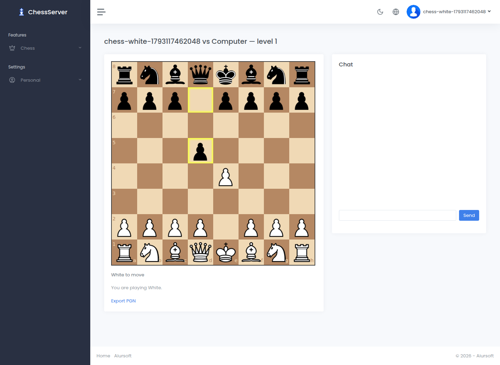

# ChessServer

[](https://github.com/aiursoftweb/chessserver/blob/master/LICENSE)
[](https://gitlab.aiursoft.com/aiursoft/chessserver/-/pipelines)
[](https://gitlab.aiursoft.com/aiursoft/chessserver/-/pipelines)
[](https://s360.aiursoft.com/SupplyChain?tab=projects&project=aiursoft%2Fchessserver&scope=baseline&ecosystem=all)
[](https://manhours.aiursoft.com/r/github.com/aiursoftweb/chessserver.html)
[](https://chess.aiursoft.com)
[](https://hub.docker.com/r/aiursoft/chessserver)

ChessServer lets signed-in players play against the computer or a friend, watch games, chat, and export PGN. Built on Aiursoft Template with eight computer difficulty levels and automatic cleanup of inactive rooms.



Sign-in uses OIDC. Configure your identity provider before playing; see [Configuration](#configuration).

## Try

Try a running ChessServer [here](https://chess.aiursoft.com).

## Install with Docker

Run the installer with the desired port (omit it to choose an available port):

```bash
curl -fsSL https://raw.githubusercontent.com/aiursoftweb/chessserver/master/install.sh | sudo bash -s -- 8080
```

Installation starts after three seconds; press Ctrl+C to cancel. Then open `http://localhost:8080`.

## Run manually

Requirements about how to run

1. Install [.NET 10 SDK](http://dot.net/) and [Node.js](https://nodejs.org/).
2. Execute `npm install` at `wwwroot` folder to install the dependencies.
3. Execute `dotnet run` to run the app.
4. Use your browser to view [http://localhost:5000](http://localhost:5000).

## Run in Microsoft Visual Studio

1. Open the `.sln` file in the project path.
2. Press `F5` to run the app.

## Run in Docker

First, install Docker [here](https://docs.docker.com/get-docker/).

Then run the following commands in a Linux shell:

```bash
image=aiursoft/chessserver
appName=chessserver
sudo docker pull $image
sudo docker run -d --name $appName --restart unless-stopped -p 5000:5000 -v /var/www/$appName:/data $image
```

That will start a web server at `http://localhost:5000` and you can test the app.

The docker image has the following context:

| Properties  | Value                           |
|-------------|---------------------------------|
| Image       | aiursoft/chessserver               |
| Ports       | 5000                            |
| Binary path | /app                            |
| Data path   | /data                           |
| Config path | /data/appsettings.json          |

## How to contribute

There are many ways to contribute to the project: logging bugs, submitting pull requests, reporting issues, and creating suggestions.

Even if you with push rights on the repository, you should create a personal fork and create feature branches there when you need them. This keeps the main repository clean and your workflow cruft out of sight.

We're also interested in your feedback on the future of this project. You can submit a suggestion or feature request through the issue tracker. To make this process more effective, we're asking that these include more information to help define them more clearly.

## Configuration

Configure `AppSettings__OIDC__Authority`, `AppSettings__OIDC__ClientId`, and `AppSettings__OIDC__ClientSecret` for your identity provider. Register `https://<your-host>/signin-oidc` as its callback. Anonymous play is disabled.

Existing Docker installations must update their persisted `/data/appsettings.json` with the new database and OIDC settings before upgrading. SQLite stores account data by default; live games remain in memory and end when the application restarts.
