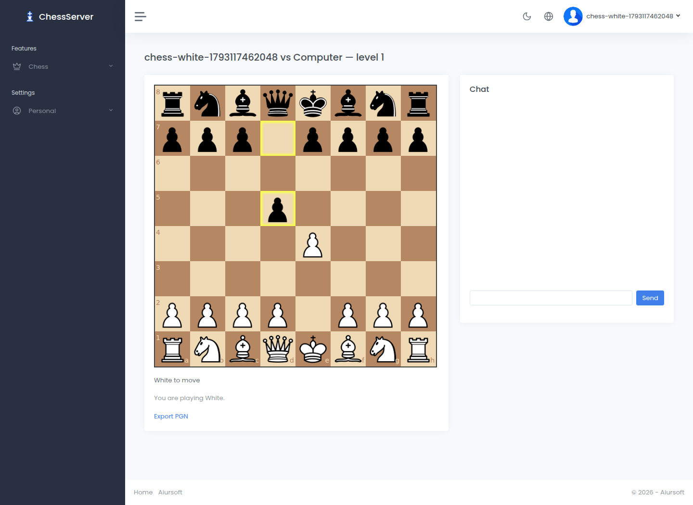

# Aiursoft ChessServer

<a name="chessserver"></a>

[](https://github.com/aiursoftweb/chessserver/blob/master/LICENSE)
[](https://gitlab.aiursoft.com/aiursoft/chessserver/-/pipelines)
[](https://gitlab.aiursoft.com/aiursoft/chessserver/-/pipelines)
[](https://s360.aiursoft.com/SupplyChain?tab=projects&project=aiursoft%2Fchessserver&scope=baseline&ecosystem=all)
[](https://manhours.aiursoft.com/r/github.com/aiursoftweb/chessserver.html)
[](https://chess.aiursoft.com)
[](https://hub.docker.com/r/aiursoft/chessserver)

ChessServer has hosted rooms with two player seats and observers. Mix humans, eight-level Lynx engines and language models in any pairing; hosts arrange players and start each game. Players can chat, and signed-in players and organizers can replay saved games and export PGN. Built on Aiursoft Template with optional server-controlled clocks.



Play with a guest nickname, or sign in with a local account or OIDC to save your games; see [Configuration](#configuration).

## Overview

### What is ChessServer?

ChessServer has hosted rooms with two player seats and observers. Mix humans, eight-level Lynx engines and language models in any pairing; hosts arrange players and start each game. Players can chat, and signed-in players and organizers can replay saved games and export PGN. Built on Aiursoft Template with optional server-controlled clocks.

## Try

Try a running ChessServer [here](https://chess.aiursoft.com).

## Install with Docker

Run the installer with the desired port (omit it to choose an available port):

```bash
curl -fsSL https://raw.githubusercontent.com/aiursoftweb/chessserver/master/install.sh | sudo bash -s -- 8080
```

Installation starts after three seconds; press Ctrl+C to cancel. Then open `http://localhost:8080`.

## Run manually

Requirements about how to run

1. Install [.NET 10 SDK](http://dot.net/) and [Node.js](https://nodejs.org/).
2. The .NET build automatically runs `npm ci` and `npm run build` to prepare the frontend assets. Node.js and npm must be available when building from source.
3. Execute `dotnet run --project src/Aiursoft.ChessServer/Aiursoft.ChessServer.csproj -- --urls http://localhost:5000` to run the app.
4. Use your browser to view [http://localhost:5000](http://localhost:5000).

## Run in Microsoft Visual Studio

1. Open the `.sln` file in the project path.
2. Press `F5` to run the app.

## Run in Docker

First, install Docker [here](https://docs.docker.com/get-docker/).

Then run the following commands in a Linux shell:

```bash
image=aiursoft/chessserver
appName=chessserver
sudo docker pull $image
sudo docker run -d --name $appName --restart unless-stopped -p 5000:5000 -v /var/www/$appName:/data $image
```

That will start a web server at `http://localhost:5000` and you can test the app.

The docker image has the following context:

| Properties  | Value                           |
|-------------|---------------------------------|
| Image       | aiursoft/chessserver               |
| Ports       | 5000                            |
| Binary path | /app                            |
| Data path   | /data                           |
| Config path | /data/appsettings.json          |

## Usage

Open the application at the URL selected in the installation or run steps above.

## Configuration

The application defaults are defined in [`src/Aiursoft.ChessServer/appsettings.json`](src/Aiursoft.ChessServer/appsettings.json). The Docker image initializes `/data/appsettings.json` on its first start and keeps it for later starts; persist `/data`. Override nested values with double-underscore environment variables, such as `Logging__LogLevel__Default`.

```jsonc
{
  "ConnectionStrings": {
    // True: cache EF Core query results in this process. False: read from the database on every query.
    "AllowCache": "True",

    // Sqlite: use a local database file and no database server. MySql: use an external MySQL server.
    // When changing this value, also replace DefaultConnection with a connection string for that provider.
    "DbType": "Sqlite",
    // With Sqlite, this creates app.db in the process working directory and applies migrations at startup.
    "DefaultConnection": "DataSource=app.db;Cache=Shared"

    // MySql requires a reachable server, database, user, and password. The application applies migrations at startup.
    // sudo docker run -d --name db -e MYSQL_RANDOM_ROOT_PASSWORD=true -e MYSQL_DATABASE=template -e MYSQL_USER=template -e MYSQL_PASSWORD=template_password -p 3306:3306 hub.aiursoft.com/mysql
    //"DbType": "MySql",
    //"DefaultConnection": "Server=localhost;Database=template;Uid=template;Pwd=template_password;"
  },
  "Storage": {
    // Writable local directory for public Workspace files and token-protected private Vault files.
    // This is not an S3 or MinIO bucket.
    // The Docker image changes /tmp/data to /data; mount /data as a persistent volume in production.
    "Path": "/tmp/data",

    // Optional second hostname for this application's own /download endpoints; this is not an S3 or MinIO URL.
    // Example: set https://files.example.com, point that DNS name to this server, and add this Caddy route:
    // files.example.com {
    //     reverse_proxy 127.0.0.1:5000
    // }
    // Replace 127.0.0.1:5000 with the same upstream used by the web UI. Leave empty to use the UI hostname.
    "PublicOrigin": "",

    // False: verified images and configured media can open on the normal web hostname.
    // True: inline viewing works only through PublicOrigin; the same request on the UI hostname downloads the file.
    // True requires PublicOrigin plus DNS, TLS, and a reverse-proxy route to this same application instance.
    "RequireDedicatedInlineOrigin": false,

    // False: only verified images and SafeInlineMediaExtensions open in the browser; every other file downloads.
    // True: every file type may open through PublicOrigin, and HTML or SVG scripts may run there.
    // True requires RequireDedicatedInlineOrigin=true and a PublicOrigin that receives no application cookies.
    "AllowArbitraryInlineOnDedicatedOrigin": false,

    // File extensions allowed to open after content-signature validation. Empty means no extra audio, video, or SVG.
    // Supported values are mp3, mp4, ogg, svg, wav, and webm. This does not grant upload permission.
    "SafeInlineMediaExtensions": ["svg"],

    // SVG opens only when svg is enabled above and its Workspace path starts with an entry in this list.
    // Example: [ "markdown-images" ]. Empty means every SVG downloads.
    "SafeInlineSvgSubfolders": ["project-logo"],

    // These values are copied into newly issued signed upload tokens; existing tokens keep their old policy.
    "UploadPolicy": {
      // False: a valid signed upload token is enough. True: the uploader must also be signed in to this application.
      "RequireAuthenticatedUser": false,

      // False: preserve spaces in uploaded file names. True: save each space as a hyphen.
      "ReplaceSpacesWithHyphens": false
    }
  },
  "AppSettings": {
    // Local: use built-in accounts and passwords. OIDC: redirect sign-in to an external identity provider.
    // Default to Local for standalone use. Production deployments select OIDC with AppSettings__AuthProvider=OIDC.
    // OIDC also requires the OIDC section below and a provider callback URL of https://<web-host>/signin-oidc.
    "AuthProvider": "Local",

    // Empty: assign no automatic role. Otherwise, assign this role to every new local or OIDC user.
    // With Local, create the role first. With OIDC, the application creates it during account synchronization.
    "DefaultRole": "",

    // False: sign-in ends when the browser session closes. True: issue a persistent sign-in cookie.
    "PersistsSignIn": false,

    // This section is used only when AuthProvider is OIDC.
    "OIDC": {
      // Provider discovery base URL. It must be reachable by the application and should use HTTPS in production.
      "Authority": "https://auth.aiursoft.com/application/o/chessserver",
      // Client identifier created for this application in the OIDC provider.
      "ClientId": "",
      // Client secret created by the provider. Set AppSettings__OIDC__ClientSecret instead of committing a real secret.
      "ClientSecret": "",

      // Claim containing role names. On every login, local roles are replaced by these roles plus DefaultRole.
      "RolePropertyName": "groups",
      // Required claim used as the local username when an OIDC account is first created.
      "UsernamePropertyName": "preferred_username",
      // Required claim copied to the local display name on every login.
      "UserDisplayNamePropertyName": "name",
      // Required unique email claim. The provider must keep it verified, unique, and stable.
      "EmailPropertyName": "email",
      // Required immutable account identifier. Keep this mapped to the standard OIDC sub claim.
      "UserIdentityPropertyName": "sub"
    },

    // This section is used only when AuthProvider is Local.
    "Local": {
      // True: show self-registration and allow new local accounts. False: existing users can sign in, but cannot register.
      "AllowRegister": true,
      // True: require only six characters. False: require eight characters with upper, lower, digit, and symbol.
      "AllowWeakPassword": true
    }
  },
  "GlobalSettings": {
    // Leave an entry commented to use the database value or built-in default.
    // Uncommenting an entry forces that value and overrides changes made in the administration UI.

    // True: users may change their display nickname. False: only administrators control it.
    // "Allow_User_Adjust_Nickname": "True",
    // Text shown as the brand name in the footer.
    // "BrandName": "Aiursoft",
    // URL opened when a user clicks the footer brand name.
    // "BrandHomeUrl": "https://www.aiursoft.com/",
    // Mainland China ICP license number. Empty hides it.
    // "Icp": "",
    // Application name shown in the web interface.
    // "ProjectName": "Aiursoft Template"
  },
  "OpenAI": {
    // Full OpenAI-compatible Chat Completions URL, for example https://your-service-address/v1/chat/completions.
    // Include /chat/completions; a hostname or /v1 base URL alone will not load any model choices.
    // The same service must expose GET https://your-service-address/v1/models using this token to list models.
    // Keep the server-side token private; existing engine opponents need no LLM configuration.
    "CompletionApiUrl": "",
    // Optional preferred model in the game creation form.
    "Model": "",
    "Token": "",
    "TimeoutSeconds": 480
  },
  "Logging": {
    "LogLevel": {
      // Minimum level for application logs. Typical values: Debug, Information, Warning, Error, or None.
      "Default": "Information",
      // Separate minimum level for ASP.NET Core framework logs; Warning reduces routine request noise.
      "Microsoft.AspNetCore": "Warning"
    },
    "Clickhouse": {
      // False: do not send logs to ClickHouse. True: create TableName at startup and send logs in batches.
      // Before enabling, provide a reachable ClickHouse server and valid credentials in ConnectionString.
      "Enabled": false,
      // ClickHouse host, protocol, port, credentials, and database. Used only when Enabled is true.
      "ConnectionString": "Host=localhost;Protocol=http;Port=8123;User=default;Password=;Database=AspNetCoreLogs",
      // ClickHouse table created and used for application logs when Enabled is true.
      "TableName": "TemplateLogs"
    }
  },
  // ASP.NET Core Host-header allowlist; this is not a CORS setting.
  // * accepts every hostname. In production, use semicolon-separated names such as example.com;www.example.com.
  "AllowedHosts": "*"
}
```

Local accounts and passwords are enabled by default. For production OIDC sign-in, set the environment variable `AppSettings__AuthProvider=OIDC` and configure `AppSettings__OIDC__Authority`, `AppSettings__OIDC__ClientId`, and `AppSettings__OIDC__ClientSecret` for your identity provider. Register `https://<your-host>/signin-oidc` as its callback. Guests can play without signing in.

SQLite stores accounts and chess sessions by default. Existing Docker installations retain `/data/appsettings.json` when upgrading; to switch an existing OIDC installation to local sign-in, set `AppSettings__AuthProvider=Local` or update `AppSettings:AuthProvider` in that file. Keep the database and data-protection keys to resume games after a restart.

For an LLM opponent, set `OpenAI:CompletionApiUrl` to the full Chat Completions URL, such as `https://your-service-address/v1/chat/completions`, and configure the server-side `OpenAI:Token` in `appsettings.json` (or use `OpenAI__CompletionApiUrl` and `OpenAI__Token` environment variables). A hostname or `/v1` base URL alone is insufficient. The same service must support `GET https://your-service-address/v1/models` with that token; its model IDs populate the choices. `OpenAI:Model` is an optional preferred model, not a replacement for the models endpoint.

Restart the application after changing these settings, sign in, then create a room and select **Add AI → LLM → model**. The original eight engine levels remain available.

### Shared settings

- `ConnectionStrings` selects the database provider and connection. Prepare the external database before choosing MySQL; keep the SQLite file persistent when using SQLite.
- `Storage` configures local application files. Keep the storage directory persistent and use the documented hostname and upload policies for shared downloads.
- `AppSettings` controls authentication and account synchronization. Choose local accounts or configure the OIDC authority, client and `/signin-oidc` callback; use environment variables for credentials.
- Uncommented `GlobalSettings` entries override the database-backed administration settings. Leave entries commented to use the stored values or application defaults.
- `Logging:LogLevel` controls application and framework verbosity. Configure the optional ClickHouse exporter only when its server and credentials are ready.
- `AllowedHosts` is the ASP.NET Core Host-header allowlist, not a CORS setting.

## How to contribute

There are many ways to contribute to the project: logging bugs, submitting pull requests, reporting issues, and creating suggestions.

Even if you with push rights on the repository, you should create a personal fork and create feature branches there when you need them. This keeps the main repository clean and your workflow cruft out of sight.

We're also interested in your feedback on the future of this project. You can submit a suggestion or feature request through the issue tracker. To make this process more effective, we're asking that these include more information to help define them more clearly.

## License

Licensed under the [MIT License](LICENSE).
